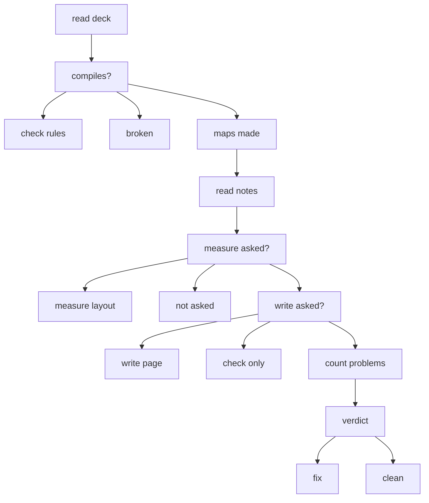
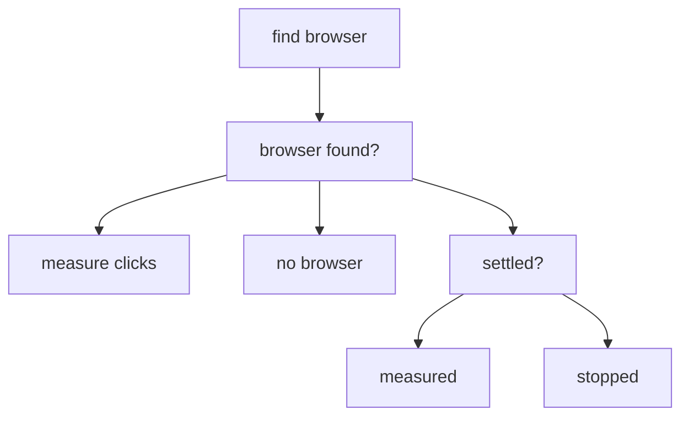

# run/ — one run of a deck, and what it answers

**Why.** Whoever edits a deck — a person, or an assistant doing it for them — needs one thing after an edit: is it
right, and if not, what do I fix. This folder is that one answer. `storydeck check` and `storydeck build` are the same
run: a build is a check that also writes the page, so the two can never disagree. The run is a
[footprintjs](https://github.com/footprintjs/footPrint) flowchart, so every choice it makes is on its record with the
rule that chose and the value it read. The reply is made from what the run found and where the log says it stands:
nothing is worked out twice.

```bash
storydeck build my-talk            # the one call after an edit
```

```text
fix 3 — 1 error, 2 warnings
error click 12 "db" · hidden-loop: 1 endless animation on gear keeps running while the slide is hidden — make it a loop …
warn  click 4 "server" · words: the headline is 14 words (at most 12) — keep the canvas short and move the rest into the notes
warn  click 9 "cache" · spills: text spills out of "cache" by 12 px wide ("Cache") — shorten it, or give the box more room
✓ index.html · 57 clicks · 412 KB · 38 ms
since the last run: 2 fixed, 1 new · round 3
```

The first line is the verdict: `clean`, `fix <n>`, or `broken` (the deck does not compile, and nothing is written).
Then each problem, worst first — what there is to fix, then the notes — at most 30 lines (`--all` lists every one).
Then what was written, and where this run stands against the one before.

A run that finds nothing is not always clean. What a browser found stays open until a browser measures again, so a
build without `--layout` after one that found a spill begins:

```text
clean so far — 1 problem a browser found before was not measured again (--layout measures)
```

## The chart

Drawn by `toMermaid()` from the real chart (`run.js · runMermaid`); a test fails when a drawing and its chart differ.



The browser is an adapter with a chart of its own, mounted at `measure layout`:



| Module | Its one job |
|---|---|
| `chart.js` | the run's wiring, as data: which stage follows which, and where the adapter is mounted |
| `stages.js` | what each stage does: read and compile once, check the rules, put on the record how each isometric map was made (`maps made`: who placed its blocks, the tile, its cables, what the build could not do — so the log answers "why is that wire straight" without the page being looked at), read the notes, write the page, count, give the verdict |
| `measure.js` | the browser, as an adapter: find one, open the page offline, measure every click, say what it found or why it could not |
| `engine.js` | the one module that calls footprintjs: builds a chart from wiring, runs it with the recorders, hands back what they hold |
| `run.js` | `runDeck`: build the chart, run it, keep the run, hand back what a reply is made of |
| `reply.js` | the reply, as text: verdict, problems, what was written, what changed |
| `log.js` · `logText.js` | the runs of a deck, kept with the person, and `storydeck log` as text |

## Laws

- **One reading.** The deck is read and compiled once. That reading is checked, measured and written, so an edit made
  while a run measures is not in its page: what was checked is what was written.
- **Where a run goes next is a decision.** Compiled or not, measured or not, a browser or none, settled or not, written
  or not, fix or clean: a decider chooses with `decide()`. How a stage does its own job is a fact it writes (where the
  browser came from, whether the page carries the person's voice), so the record can say that too.
- **The record holds facts.** Counts, verdicts, and the problems found (the tool's own words about the deck). The
  compiled deck and its page are too big to be facts: they stay in the run's working memory.
- **A tool outside is a named call.** Each step through the browser is `scope.$call('browser.measure', …)`: one line of
  the record a call, with its time and how it ended. Every call has a time limit (`measure.js · CALL_LIMITS`), above the
  browser's own time-outs: a call that never answers ends as a recorded time-out that names it, and the run goes on to
  say so.
- **Recorders are attached once, at the top** (`engine.js · runChart`): the run in words, each stage's time, each
  tool's calls counted by name. The log reads them; no stage reports about itself. (The time on a reply's `✓` line is
  the whole run, as whoever ran it waited for it.)
- **What a browser found stays open until a browser measures again.** A run that did not measure cannot know, so it
  never counts a browser's finding as fixed, and never closes a series that has one open (`log.js · progress`). A
  measure that stopped found nothing about the deck: its error is that run's own, new each time and never carried.
- **An adapter reports, the run decides.** The browser adapter hands back `{measured, layoutProblems, layoutNote?}`.
  Whether that stops a build is the run's to say (it does not: a build says what to fix, and writes the page).

## The log

Every check and build leaves one small file with the person (`STORYDECK_HOME`, or `~/.storydeck`), never in the deck:
its verdict, its counts, which problems were open, each stage's time, each tool's calls and the run in words. Beside
it the engine keeps the record itself, written as the run goes, so a run that was cut short still says which call it
was in. A deck keeps its newest 30 runs.

```bash
storydeck log my-talk              # the runs, newest first, and how the fixing went
storydeck log my-talk --run 1      # one run in full
```

```text
3 runs kept (the newest 30 are)
1 series of fixing closed: 2 rounds each on average, beginning with 5 to fix
tool calls: outline 1, review 4, check 1, build 2, log 1
 1  2026-11-19 19:40:03  build  clean — nothing to fix · clean after 2 rounds · 57 clicks · measured · 4210 ms
 2  2026-11-19 19:38:40  build  fix 2 — 0 errors, 2 warnings · round 2 · 3 fixed, 0 new · 57 clicks · 41 ms
 3  2026-11-19 19:36:12  check  fix 5 — 1 error, 4 warnings · round 1 · 57 clicks · 39 ms
one run in full: storydeck log --run <its number>
```

A round is a run that ended with something open; rounds in a row are one series, and a run with nothing open closes
it. So the log answers how much work a deck took: how many rounds, beginning with how many problems, and how many
tool calls (each read-first tool counts its call in `calls.json`, in the same folder). A run that could not finish (a
page that may not be written) is kept to be read, and stands outside the rounds. What the log cannot count is what
happens outside StoryDeck: an assistant's own model calls, or pictures it looked at.

To read the record itself: `readRecordFile(file)` from `footprintjs/sinks` gives its entries, and
[foottrace](https://github.com/footprintjs/foottrace)'s readers walk them.

## What can go wrong, and what is done about it

- **A deck is someone else's folder.** Nothing of the person's is written into it: the log lives with the person, and a
  StoryDeck folder set inside the deck keeps nothing and says why.
- **A kept run is a file.** What is read back is read as a file anyone may have put there: only names this folder
  writes, plain files (never a link), bounded in size, and each field taken by its type. Its text reaches a terminal or
  a model as plain text (`tools.js · printable`).
- **A deck's words are in the record.** A problem names a click's label and quotes a few words. The log is the person's
  own, readable by them alone (0700 folder, 0600 files).
- **The log never costs the answer.** A folder that cannot be written keeps nothing; the reply says so in one line.
- **A page that hangs.** Every call through the browser has a time limit; the browser is closed whatever happens (one
  still starting when its opening was given up on is closed as it arrives), and the folder the page was opened from is
  removed. A browser that does not close when asked is recorded as timed out: StoryDeck cannot end it, and says so.
