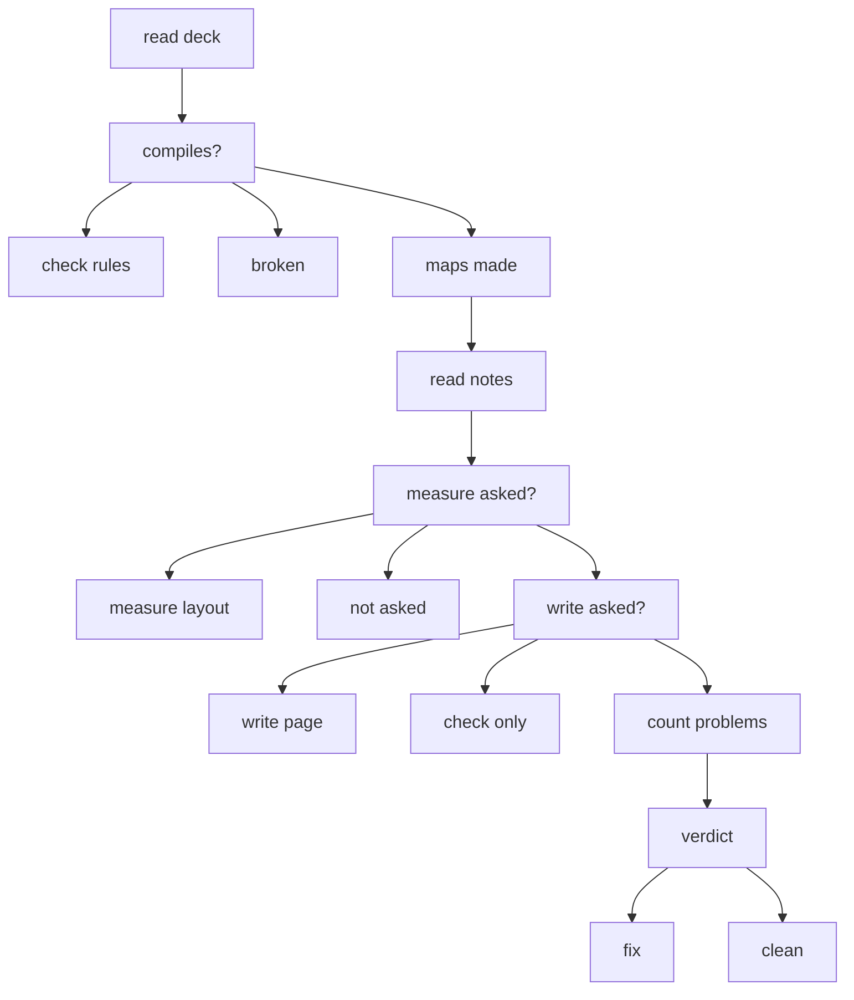
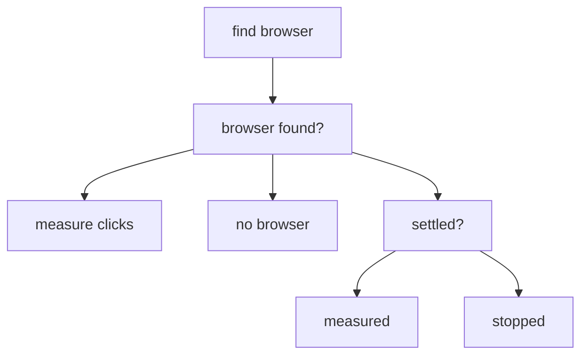

# run/ — one run of a deck, and what it answers

**Why.** Whoever edits a deck — a person, or an assistant doing it for them — needs one thing after an edit: is it
right, and if not, what do I fix. This folder is that one answer. `storydeck check` and `storydeck build` are the same
run: a build is a check that also writes the page, so the two can never disagree. The run is a
[footprintjs](https://github.com/footprintjs/footPrint) flowchart, so every choice it makes is on its record with the
rule that chose and the value it read. The reply is made from what the run found and where the log says it stands:
nothing is worked out twice.

```bash
storydeck build my-talk            # the one call after an edit
```

```text
fix 3 — 1 error, 2 warnings
error click 12 "db" · hidden-loop: 1 endless animation on gear keeps running while the slide is hidden — make it a loop …
warn  click 4 "server" · words: the headline is 14 words (at most 12) — keep the canvas short and move the rest into the notes
warn  click 9 "cache" · spills: text spills out of "cache" by 12 px wide ("Cache") — shorten it, or give the box more room
✓ index.html · 57 clicks · 412 KB · 38 ms
since the last run: 2 fixed, 1 new · round 3
```

The first line is the verdict: `clean`, `fix <n>`, or `broken` (the deck does not compile, and nothing is written).
Then each problem, worst first — what there is to fix, then the notes — at most 30 lines (`--all` lists every one).
Then what was written, and where this run stands against the one before.

A run that finds nothing is not always clean. What a browser found stays open until a browser measures again, so a
build without `--layout` after one that found a spill begins:

```text
clean so far — 1 problem a browser found before was not measured again (--layout measures)
```

## The chart

Drawn by `toMermaid()` from the real chart (`run.js · runMermaid`); a test fails when a drawing and its chart differ.



The browser is an adapter with a chart of its own, mounted at `measure layout`:



| Module | Its one job |
|---|---|
| `chart.js` | the run's wiring, as data: which stage follows which, and where the adapter is mounted |
| `stages.js` | what each stage does: read and compile once, check the rules, put on the record how each isometric map was made (`maps made`: who placed its blocks, the tile, its cables, what the build could not do — so the log answers "why is that wire straight" without the page being looked at), read the notes, write the page, count, give the verdict |
| `maps.js` | each isometric map built again by footprint-story's map flow, at `maps made`, with its own record (`flowMaps`); a map flow whose map is not the page's is said (`differs`) |
| `motions.js` | each map whose blocks move (`data-move`): its moves planned again through footprint-story's intent decider as a chart (`runHumanFlow`), at `maps made`, with its own record (`flowMotions`); a plan that is not the page's is said (`differs`) |
| `measure.js` | the browser, as an adapter: find one, open the page offline, measure every click, say what it found or why it could not |
| `engine.js` | the one module that calls footprintjs: builds a chart from wiring, runs it with the recorders, hands back what they hold |
| `run.js` | `runDeck`: build the chart, run it, keep the run, hand back what a reply is made of |
| `reply.js` | the reply, as text: verdict, problems, what was written, what changed |
| `log.js` · `logText.js` | the runs of a deck, kept with the person, and `storydeck log` as text |
| `why.js` | `storydeck log --why <key> [--map <map> \| --motion <map>]` as text: walked back from the run's record, from one map's, or from the record of one map's moves (`--why duration-0 --motion map`) |

## Laws

- **One reading.** The deck is read and compiled once. That reading is checked, measured and written, so an edit made
  while a run measures is not in its page: what was checked is what was written.
- **Where a run goes next is a decision.** Compiled or not, measured or not, a browser or none, settled or not, written
  or not, fix or clean: a decider chooses with `decide()`. How a stage does its own job is a fact it writes (where the
  browser came from, whether the page carries the person's voice), so the record can say that too.
- **The record holds facts.** Counts, verdicts, and the problems found (the tool's own words about the deck). The
  compiled deck and its page are too big to be facts: they stay in the run's working memory.
- **A tool outside is a named call.** Each step through the browser is `scope.$call('browser.measure', …)`: one line of
  the record a call, with its time and how it ended. Every call has a time limit (`measure.js · CALL_LIMITS`), above the
  browser's own time-outs: a call that never answers ends as a recorded time-out that names it, and the run goes on to
  say so.
- **Recorders are attached once, at the top** (`engine.js · runChart`): the run in words, each stage's time, each
  tool's calls counted by name. The log reads them; no stage reports about itself. (The time on a reply's `✓` line is
  the whole run, as whoever ran it waited for it.)
- **What a browser found stays open until a browser measures again.** A run that did not measure cannot know, so it
  never counts a browser's finding as fixed, and never closes a series that has one open (`log.js · progress`). A
  measure that stopped found nothing about the deck: its error is that run's own, new each time and never carried.
- **An adapter reports, the run decides.** The browser adapter hands back `{measured, layoutProblems, layoutNote?}`.
  Whether that stops a build is the run's to say (it does not: a build says what to fix, and writes the page).

## The log

Every check and build leaves one small file with the person (`STORYDECK_HOME`, or `~/.storydeck`), never in the deck:
its verdict, its counts, which problems were open, each stage's time, each tool's calls and the run in words. Beside
it the engine keeps the record itself, written as the run goes, so a run that was cut short still says which call it
was in. A deck keeps its newest 30 runs.

```bash
storydeck log my-talk              # the runs, newest first, and how the fixing went
storydeck log my-talk --run 1      # one run in full
storydeck log my-talk --run 1 --why verdict   # where that value came from, walked back from the run's record
```

```text
3 runs kept (the newest 30 are)
1 series of fixing closed: 2 rounds each on average, beginning with 5 to fix
tool calls: outline 1, review 4, check 1, build 2, log 1
 1  2026-11-19 19:40:03  build  clean — nothing to fix · clean after 2 rounds · 57 clicks · measured · 4210 ms
 2  2026-11-19 19:38:40  build  fix 2 — 0 errors, 2 warnings · round 2 · 3 fixed, 0 new · 57 clicks · 41 ms
 3  2026-11-19 19:36:12  check  fix 5 — 1 error, 4 warnings · round 1 · 57 clicks · 39 ms
one run in full: storydeck log --run <its number>
```

A round is a run that ended with something open; rounds in a row are one series, and a run with nothing open closes
it. So the log answers how much work a deck took: how many rounds, beginning with how many problems, and how many
tool calls (each read-first tool counts its call in `calls.json`, in the same folder). A run that could not finish (a
page that may not be written) is kept to be read, and stands outside the rounds. What the log cannot count is what
happens outside StoryDeck: an assistant's own model calls, or pictures it looked at.

To read the record itself: `readRecordFile(file)` from `footprintjs/sinks` gives its entries, and
[foottrace](https://github.com/footprintjs/foottrace)'s readers walk them.

## What can go wrong, and what is done about it

- **A deck is someone else's folder.** Nothing of the person's is written into it: the log lives with the person, and a
  StoryDeck folder set inside the deck keeps nothing and says why.
- **A kept run is a file.** What is read back is read as a file anyone may have put there: only names this folder
  writes, plain files (never a link), bounded in size, and each field taken by its type. Its text reaches a terminal or
  a model as plain text (`tools.js · printable`).
- **A deck's words are in the record.** A problem names a click's label and quotes a few words. The log is the person's
  own, readable by them alone (0700 folder, 0600 files).
- **The log never costs the answer.** A folder that cannot be written keeps nothing; the reply says so in one line.
- **A page that hangs.** Every call through the browser has a time limit; the browser is closed whatever happens (one
  still starting when its opening was given up on is closed as it arrives), and the folder the page was opened from is
  removed. A browser that does not close when asked is recorded as timed out: StoryDeck cannot end it, and says so.

## Asking why

A run's record holds every commit as it was written, with the keys each stage had read by then; the run's own file
holds which decision let each step run. So one value can be asked for, and nothing is run again:

```text
$ storydeck log my-talk --run 1 --why verdict
verdict = "fix"
fix (fix#11) [wrote: verdict]
  verdict (verdict#10) ← [control: There is a warning to fix] [wrote: verdictWhy]
    count problems (count-problems#9) ← via errors [wrote: errors, warnings, infos]
      check rules (check-rules#2) ← via problems [wrote: problems]
        compiles? (compiles#1) ← [control] [wrote: compiledWhy]
          read deck (read-deck#0) ← via compiled [wrote: writeAsked, layoutAsked, voiceAsked, compiled, clicks, problems]
(a stage also uses what it is given from outside the run's own state: the record holds what stages read and wrote, and no more)
```

The reader is `footprint-story/record` · `whyFromRecord`, the same one StoryReel uses: the record is read as a file
anyone may have written (bounded, one run, every line of the answer one line), and one that is not whole says so
first. Two things in `stages.js` exist for it: every decider writes its reason (`compiledWhy`, `measureWhy`,
`writeWhy`, `verdictWhy`), because a record keeps a stage's reads with what it writes; and what a stage is given from outside the run's state (the deck's
files, a browser) is in no record, which every answer ends by saying.

A run that measured in a browser mounts the adapter's chart, which keeps a log of its own in the same record: the
run's own log is walked, and the answer says so. A run kept before 0.21.0 has a record without the reads: its answer
shows who wrote the value and the decisions, and says the reads are not there. Where a rule read two counts
(`errors`, `warnings`) the walk names the stage that wrote them once, by the first: `--why warnings` shows that count's
own path.

## Asking why a map is so

A deck with an isometric map has each map built twice: by the compile, with footprint-story's `buildIsoMap`, to draw
the page; and by the run, at `maps made`, with footprint-story's map flow (`runMapFlow`, a footprintjs chart of the same
steps), so a record holds a real run of them. Each map's run keeps its own record, beside the run's:
`<run id>.map-<k>.record.jsonl`, k its place in the run's list (a record holds one run; a file is never named by the
deck's words). `--map` picks which record `--why` reads, by the deck's own name for the map — the name a part's
`data-map` gives, the one `maps made` writes:

```text
$ storydeck build my-talk
clean — nothing to fix
✓ my-talk/index.html · 5 clicks · 178 KB · 71 ms
maps: map — why a block stands where it does: storydeck log --run 2026-11-21T23-11-07-965Z-build.3c220e --why at --map map
$ storydeck log my-talk --run 2026-11-21T23-11-07-965Z-build.3c220e --why at --map map
at = [[0,5,0],[4,1,0],[7,4,0],[12,2,0]]
place: hand (hand#2) [wrote: at]
  read (read#0) ← via blocks [wrote: who, blocks, floors, wires, obstacles, keep, written, usualGrid, area, style, policy]
    ⚠ also consumed args — slice may be incomplete here
  place (place#1) ← [control: every block has an at: the map placed them] [wrote: placed, placedWhy]
    ↳ read#0 (see above)
(a stage also uses what it is given from outside the run's own state: the record holds what stages read and wrote, and no more)
```

That is the example deck (`examples/a-request`), whose blocks are placed by hand. A map whose blocks the build places
answers through `place: build` (`[control: no block has an at: the build places them from their wires, …]`). `--why
view` answers through the grid's decision — written in numbers, fitted, or the usual grid (`[control: no grid is
written and the map placed its blocks: it is the usual grid the tool handed in]`) — and `--why names` through the
names step. `--why` with no key is refused, as the run's own is, naming what that map's run wrote. Pinned by
`maps.test.js`.

**The ⚠ line.** The `read` step takes the spec and the policy as the run's input, not from the run's state, so no
earlier step wrote what it read and the walk ends there: what `read` took is the map as the deck wrote it.

- **The same spec, the same policy.** The compile keeps the spec it handed `buildIsoMap`, frozen at every level
  (`isoSpec.js` · `builtMap`, the compiled map's `built`), and the run hands that very spec, with the deck's policy, to
  the map flow (`maps.js` · `flowMaps`): never one made again.
- **The two maps must be equal.** footprint-story pins it with a property test; the run compares them again. A
  difference is a `drift` line in the reply (where they first part, both values) and heads every answer for that map.
  It counts in no verdict: the page draws the deck's map.
- **A tool outside is a named call.** Each map flow is `scope.$call('map.flow', …)` with a time limit (30 s, `maps.js` ·
  `MAP_FLOW_MS`): the run's record and its log count them (`map.flow × 1: 26 ms`). One that throws, returns no map or
  never settles is a `drift` line saying so; the run goes on, and a record it began is removed. The bound on closing a
  record is a timer that is not unref'd: unref'd, a promise that never settles lets node end before it.
- **Nothing new for a deck with no isometric map**: no call, no record, and its reply as it was. A run kept from 0.34.0
  says which maps it built again (`maps`, empty when none) and names the deck's others (`flat`). At most 32 maps a run
  (`MAPS_MOST`); the rest are counted, and the reply says so.
- **A record that cannot be written never costs the run.** The map is still built and compared, and the reply says
  `map map: its record was not kept`. A map's record goes when its run is dropped.
- **The call the reply offers names the run by its id**: a run's number moves when another is kept. `--run` takes
  either, and an answer asked by id names the run by it. A map's name is quoted past letters, digits and `_`; one the
  command line would read as a flag (it starts with `--`) is never offered.
- **Refusals name what there is**: an unknown map names the run's maps; a run with none says why (no isometric map, or
  a deck that did not compile) and names the deck's maps; a run kept before 0.34.0 says it kept no map records.
- **Cost.** A map of 100 blocks takes about 45 ms more to build when its blocks are placed by hand, and 65–85 ms when
  the build places them (measured on one laptop, by the run's own `map.flow` call times). Its record is about 180–230 KB
  for each map, each kept run: a deck keeps 30 runs, so one such map holds up to about 7 MB of records, and a deck of
  several reaches tens of MB (at most 32 maps a run). They go with their runs.
